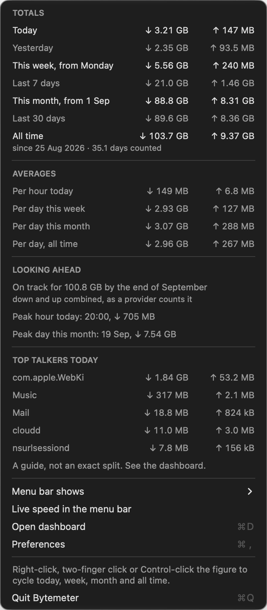
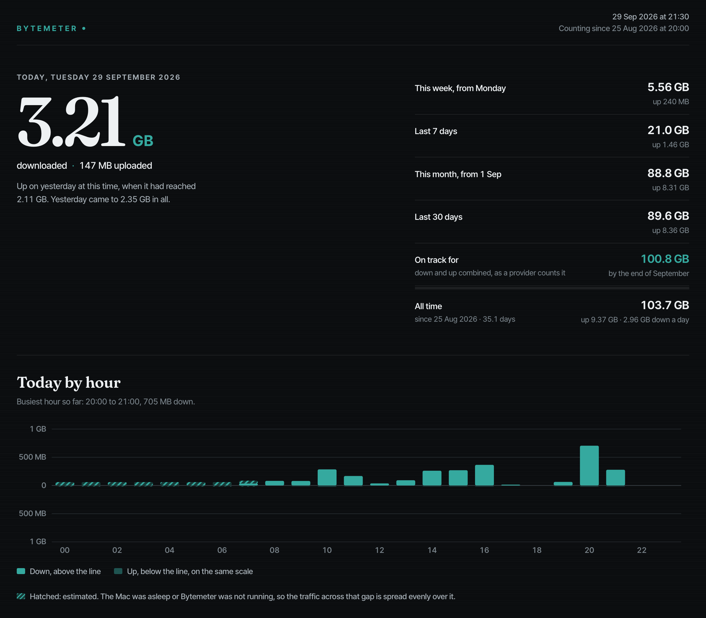
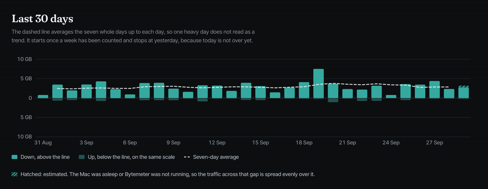
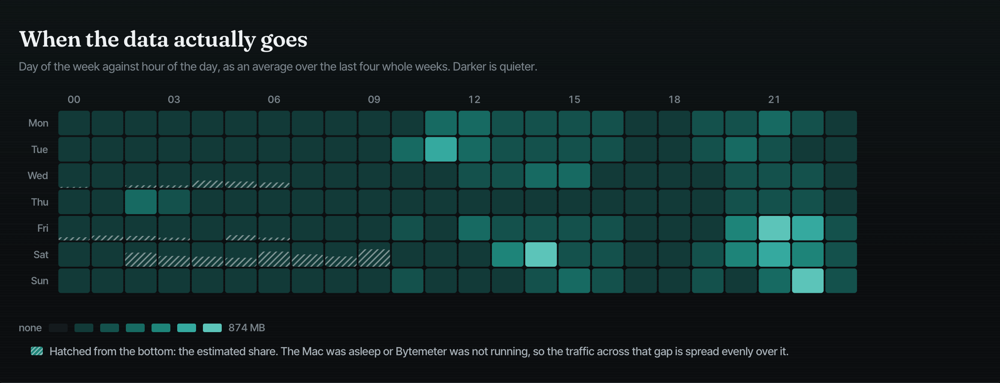

# Bytemeter

**A macOS menu bar app that counts every byte your Mac sends and receives, and never sends one itself.**

[](https://github.com/Adi-debug-source/bytemeter/actions/workflows/test.yml)

Bytemeter sits in the menu bar and shows how much data your Mac has used today, this week, this month or since it started counting. Click it for the detail, or open a dashboard with charts and a CSV export. It is written in Swift, needs macOS 13.5 or later, and makes no network requests of any kind: a tool that measures data use should not spend data.

<p align="center">
  
  &nbsp;
  
</p>

The pictures on this page are the real app showing generated demo data (`Scripts/make_demo_db.py`), not anyone's usage.

## Install

```bash
git clone https://github.com/Adi-debug-source/bytemeter.git
./bytemeter/install.sh
```

That builds the app on your Mac, puts it in `~/Applications` and starts it at login. You need macOS 13.5 or later and the Xcode Command Line Tools (`xcode-select --install`), not full Xcode. Run the second line again after a `git pull` to update. More, including Homebrew, is under [Install and remove](#install-and-remove).

## What it does

- **A total in the menu bar.** Today, this week, this month or all time. Choose which from the menu, or right-click the figure to step through them. A live speed can sit beside it.
- **A menu with the detail.** Seven totals, the averages per hour and per day, where the month is heading, the busiest hour and day, and the apps that used the most today.
- **A monthly cap.** Set your allowance in GB and the day your billing cycle starts, and the menu shows a bar with what is used, what is left and how many days are to go.
- **A dashboard.** One dark page with today by hour, the last 30 days with a seven-day average, a heatmap of when your data goes, a breakdown by app, by interface and by Wi-Fi network, idle against active, and month by month. It comes with a CSV export.
- **Exact figures.** Bytemeter records what the kernel's own interface counters say, to the byte, and picks up where it left off after a sleep, a restart, a crash or a quit.
- **Private by design.** Nothing leaves your Mac. There are no accounts, no analytics and no update checks, and the dashboard page loads nothing from the internet.
- **Light.** While it sits in the menu bar it uses about 12 MB of memory and under a tenth of one per cent of a processor core.

## For anyone reading the code

Bytemeter is a small project with one claim: its figures match what the network interfaces carried. Most of the work is in keeping that claim true.

- **It found a trap in the usual way of counting.** `getifaddrs`, which most examples use, returns 32-bit byte counters on macOS, so they wrap every 4.29 GB and quietly lose it. Bytemeter reads the 64-bit counters from the interface MIB through `sysctl` instead, and its figures match `netstat -ib` exactly. See [Where the counters come from](#where-the-counters-come-from).
- **It is tested where it matters.** The self-test runs 1,278 checks on the counting rules: restarts, interface resets, counter wraps, sleep, a clock set backwards, clock changes in every time zone, database upgrades from every earlier version, and a failed write that must move nothing. CI runs it on every push, builds the app from a clean clone and checks that the dashboard page fetches nothing.
- **Every figure comes from one table.** Totals, averages, the projection and the charts are all worked out from the same minute rows when they are asked for, so no two figures on screen can disagree.
- **It has no dependencies.** Swift, AppKit, SQLite and `nettop`, all of which ship with macOS. The dashboard is hand-written HTML and inline SVG with no JavaScript. It builds with the Command Line Tools alone.
- **Its cost is measured, not guessed.** Sitting in the menu bar it takes 0.05% to 0.07% of one processor core and about 12 MB of memory on the Mac it was developed on, or 0.7% with the live speed redrawing every second. `Scripts/measure_idle.sh` and `swift run -c release BytemeterSelfTest --measure` repeat the measurement.
- **It says what it does not know.** Per-app figures are a guide, traffic across a sleep has its timing estimated and is drawn hatched, and the limits are written down under [How accurate it is](#how-accurate-it-is).

The code is in four parts, split on purpose:

| Part | What it is |
|---|---|
| `Sources/BytemeterCore` | The engine: reading the counters, spotting resets, minute buckets, the SQLite schema, every total and the menu's wording. Nothing macOS-only, so an iOS version could use it untouched |
| `Sources/BytemeterDashboard` | The dashboard page and the CSV export, built from the engine with Foundation alone |
| `Sources/Bytemeter` | The macOS app: the menu bar item, per-app sampling, the Wi-Fi network name, Preferences, sleep and wake |
| `Sources/BytemeterSelfTest` | The checks, one file per subject |

[MAINTENANCE.md](MAINTENANCE.md) covers building, releasing and the decisions behind the login item, and [CHANGELOG.md](CHANGELOG.md) says what each version changed and why.

## The menu bar

The menu bar item shows one total, with monospaced digits so its width does not jitter as the figure changes.

- Left-click opens the menu.
- **Menu bar shows**, in the menu, chooses the total: Today, This week, This month or All time. Right-click, a two-finger click or a Control-click on the figure steps through the same four. The choice is kept across restarts.
- Live speed is a separate switch in the menu. When it is on, the current rate appears beside the total; it never replaces it.

The menu holds:

- **Totals:** today, yesterday, this week (from Monday), the last 7 days, this month (from the 1st), the last 30 days, and all time since counting began. The four totals the menu bar can show are drawn at full contrast; the rest are grey. All time shows its start date and day count beneath it, for example "since 1 Jan 2026 · 90.0 days counted".
- **Averages:** per hour today, per day this week, per day this month, and per day across all time.
- A **month-end projection** (download and upload combined, as a provider counts them), the **peak hour** and the **peak day**, and the **cap** when one is set. Every other headline figure is download; the projection and the cap are the figures that add the two together, and the projection says so beside its figure. The projection carries the month's rate so far on to its end. On the first day of a month it runs the last 24 hours on instead, and with under a day counted at all it says it is too early to project.
- **Top talkers** today, per app.
- **Menu bar shows**, **Live speed in the menu bar**, **Open dashboard** (⌘D), **Preferences** (⌘,) and **Quit Bytemeter** (⌘Q).

If recording stops because the database cannot be written, for example on a full disk, a line at the top of the menu says so and since when, and on a new install, until the first figures arrive, it says counting has started.

## Preferences

Preferences, from the menu, has five settings:

1. **Live speed in the menu bar**, beside the total and never in its place. It can be switched from the menu too.
2. **Per-app sampling with `nettop`**, on by default. While it is off, nothing new is recorded per app, the menu says so where Top talkers would be, and the dashboard's Top talkers says so too.
3. **The Wi-Fi network name**, off by default. It needs Location Services, for the reasons under [What it collects, and where it stays](#what-it-collects-and-where-it-stays). While it is on and macOS allows it, the dashboard splits traffic by network.
4. **A monthly cap in GB**, off by default. The menu shows a bar with the percentage used, and the dashboard a Monthly cap panel, and both say what is left and how many days are to go, or how far over the cap the month is. It counts download and upload together, as a provider does, over the month or the billing cycle below. It is a figure to watch, and sends no alert.
5. **The day the billing cycle starts**, from 1 to 28. 1, the default, means calendar months. On any other day, this month becomes this cycle in the menu and on the dashboard, including the averages, the projection, the peak day and Month by month.

## The dashboard

Open dashboard writes one dark, self-contained HTML page and opens it. It is made again each time, with hand-rolled inline SVG and native SVG tooltips: zero JavaScript, zero network requests. A CSV export sits beside it as a real file.

The top of the page gives today's download, compared with yesterday at the same time of day, beside this week, the last 7 days, this month, the last 30 days, the projection and all time, then a Monthly cap panel when a cap is set.

Seven sections, and an eighth once a second month begins:

1. Today, by hour.
2. The last 30 days, with a seven-day average of whole days counted, which stops at yesterday because today is not over.
3. A day-of-week against hour-of-day heatmap, an average over the last four whole weeks, so every weekday counts the same.
4. Top talkers, per app.
5. Idle against active.
6. Per interface, each under the name macOS gives its port, such as Wi-Fi (en0) or iPhone USB (en7), so a phone sharing its connection over a cable is told apart from the Wi-Fi.
7. Per network.
8. Month by month, once a second month begins.

The footer says how the figures are made and lists recent events in plain words, such as a sleep with how long it lasted and how much traffic was spread across it.





## Install and remove

Both routes build Bytemeter on your own Mac. They need macOS 13.5 or later, the first release that runs Swift 5.9, and the Xcode Command Line Tools, version 15 or later (`xcode-select --install`), not full Xcode.

From a clone:

```bash
git clone https://github.com/Adi-debug-source/bytemeter.git
./bytemeter/install.sh
```

`install.sh` builds the app with `swift build -c release`, ad-hoc signs `Bytemeter.app`, copies it to `~/Applications`, and adds a login item so it starts at login. The login item restarts the app after a crash, but if you quit it, it stays quit until the next login. It is safe to run again after `git pull` to update. The options are:

- `--uninstall`: removes the app and the login item, and keeps your data.
- `--dry-run`: says what it would do and changes nothing.
- `--bundle-only DIR`: builds the app without installing it.
- `--app PATH`: installs an app that is already built.

With [Homebrew](https://brew.sh):

```bash
brew tap adi-debug-source/bytemeter https://github.com/Adi-debug-source/bytemeter
brew install adi-debug-source/bytemeter/bytemeter
bytemeter-setup
```

The formula lives in this repository, so the first line points Homebrew at it once. The second fetches and builds Bytemeter. The third copies the app to `~/Applications` and adds the login item, because Homebrew cannot write to your home folder itself. After `brew upgrade bytemeter`, run `bytemeter-setup` again. To remove it, run `bytemeter-setup --uninstall`, then `brew uninstall bytemeter`; your usage history is kept.

Bytemeter is not notarised, and it does not need to be. Both routes build it on your own Mac, so there is no downloaded app for macOS to quarantine, and it opens without a warning.

## What it collects, and where it stays

Bytemeter reads the kernel's own interface byte counters every 5 seconds and keeps per-app totals from `nettop`. It writes minute-level rows to a local SQLite database:

```
~/Library/Application Support/Bytemeter/bytemeter.db
```

Minute rows are kept for 90 days, then collapsed to hourly, so on a typical machine the file levels off at roughly 40 MB and then grows by a few MB a year. Its log is at `~/Library/Logs/Bytemeter/bytemeter.err`.

Nothing leaves the machine. Bytemeter makes no network requests at all, not for charts, fonts or updates, and the dashboard fetches nothing when you open it.

Reading your Wi-Fi network name is off by default, and while it is off Bytemeter never touches Location Services. Switching it on in Preferences asks macOS for Location Services, because macOS treats a network name as location information. If you refuse, the feature switches itself back off and tells you where to allow it. Because each build is ad-hoc signed afresh, macOS may forget the permission after an update. Bytemeter never asks again on its own: Preferences says that network names are not being recorded, and offers to ask macOS again.

## How accurate it is

Bytemeter aims to be exact about what it can measure, and plain about what it cannot.

- **The count is exact.** Bytemeter records exactly what the kernel's own interface counters say, to the byte. On the Mac it was developed on, the sum of every saved minute since the last reboot matched the kernel counter's own movement over the same period to 0 bytes in and 0 bytes out, checked repeatedly over several days, across two reinstalls and a database migration.
- **Where it can miss bytes, and by how much.** The gaps are small and bounded:
  1. the last few seconds before a shutdown or restart, at most one 5-second reading, because the counter starts again from zero at boot;
  2. an interface reset that is not a reboot, up to one 5-second reading, because there is no start time to measure from;
  3. traffic between quitting Bytemeter and restarting the Mac before you open it again. Quitting on its own loses nothing, because the next launch picks up everything since the last reading, and a crash loses nothing either, because it restarts within seconds and does the same;
  4. an adapter, dock or tethered phone unplugged and plugged back in while Bytemeter is not running. Its counter starts again from zero when it is plugged in, and with no reading in between Bytemeter cannot tell that from a counter that kept going. It then misses what the interface carried between its last reading and the unplug, and either everything since the replug, if the new count in either direction is below the old one, or as much as the old count, if neither is. The same applies, usually to a few seconds, when it is plugged in while the Mac sleeps;
  5. traffic from before Bytemeter was first installed, which is not counted by design.
- **Timing.** Figures are kept per minute. A reading that straddles a minute boundary lands in the later minute, so a minute can be out by at most 5 seconds' worth of traffic, and hourly and daily figures the same way, only at their edges. Sleep periods are the exception: the bytes are exact, but their timing is spread evenly and marked as estimated. And if the Mac's clock is ever set ahead by hand and then corrected, new traffic is filed under the later time until the clock catches up; nothing is lost or counted twice.
- **Rounding on screen.** The menu and the dashboard round for readability: under 10 GB they show two decimals (3.21 GB, so plus or minus 5 MB), and from 10 GB up one decimal (plus or minus 50 MB). The menu bar figure is shorter, so its width stays steady: one decimal in GB, and whole numbers of MB, kB or bytes below that. A figure never shows as 1000 of a smaller unit. The database and the CSV export keep exact byte counts.
- **Per-app figures are a guide, not an exact split.** They come from `nettop`, leave out loopback traffic, which never leaves the Mac, and only ever under-report. The interface bytes no app is credited with belong to processes that exited between samples, and to traffic `nettop` does not attribute.
- **Traffic inside your own network counts too.** The interface counters cannot tell internet traffic from traffic to another device at home, so Time Machine to a network disk, a NAS, AirPlay, screen sharing and copies between Macs all count, though none of it reaches your provider.
- **Against a provider's or router's figure, expect small differences, not a match to the byte.** A provider or router counts at its own point in the network and in its own way, and a router counts every device on the connection, while Bytemeter counts only what this Mac's own interfaces moved.
- **Units are decimal** (1 GB = 1,000,000,000 bytes), as providers count; see Counting below.

## What it does not claim

Bytemeter is careful about saying what it knows and what it does not.

- **Per-app figures under-report.** They come from `nettop`, and a process that exits between samples takes its last few seconds with it, so a per-app total is a good guide rather than an exact split. The interface counters are the source of truth, and the two will not reconcile to the byte.
- **Sleep is counted, but its timing is estimated.** The traffic across a sleep is real, so it is counted, but its timing is not observed. Bytemeter spreads it evenly across the gap and marks those minutes as estimated. The dashboard draws them hatched, with a one-line key, and its tooltips say how much of a figure is estimated. Totals never change because of this.
- **"All time" means since Bytemeter started counting**, not since the Mac was new. Traffic already on the counter when Bytemeter first runs has no timestamps, so it is left out rather than folded in to flatter the figure.
- **Reboots are told from interface resets.** Bytemeter uses the kernel's boot session id, which changes only at a reboot. After a genuine reboot, everything on the counter since boot is counted. After an interface reset without a reboot, the baseline moves and nothing is booked, because there is no start time to measure from.
- **Weeks start on Monday, dates read day first, and the clock is yours.** Bytemeter uses ISO 8601 weeks and writes dates day first whatever your Mac's region is set to, by choice, so a figure means the same thing on every machine. Daily, hourly and heatmap figures track local time correctly across clock changes, including half-hour time zones.
- **It is not the first of its kind.** Other menu bar data meters exist, some with alerts and per-app limits. Bytemeter's part is being exact, open and private.

## How it works, and why

### Counting

1. **The interface counters are read every 5 seconds**, each reading diffed against the last, and the difference added to a one-minute bucket. Everything above a minute (hour, day, week, month, the averages, the projection) is computed at query time from those buckets, so no two figures on screen can ever disagree.
2. **The last raw reading is saved after every sample.** On launch the live counter is compared against the stored value, so traffic that happened while the app was not running is picked up rather than lost.
3. **A reading lower than the last one is a reset, not negative traffic.** The baseline moves and no phantom multi-gigabyte spike is booked. The kernel's boot session id, which changes only at a reboot, tells a genuine reboot (after which the bytes since boot are counted) from an interface reset (after which nothing is booked, because there is no start time to measure from).
4. **Only physical interfaces are counted**, meaning `en` followed by a number. VPN tunnels, bridges, AirDrop and loopback are all excluded, because a VPN's tunnel carries the very same bytes as the Wi-Fi interface underneath it; counting both would double every figure the moment a VPN came on.
5. **Units are decimal:** 1 GB is 1,000,000,000 bytes, the way internet providers and routers count, so the figures are in the same units as your bill.

### Where the counters come from

Not `getifaddrs`. On macOS `getifaddrs` returns a `struct if_data` whose `ifi_ibytes` is a `u_int32_t`, so it wraps every 4.29 GB, and the route-socket path `NET_RT_IFLIST2` returns the same truncated value. Either would lose roughly 4 GB at a time, silently, and every wrap would look just like a reboot.

Bytemeter reads `net.link.generic.ifdata.<index>.general` through `sysctl` instead, which fills a `struct ifmibdata` whose `ifmd_data` really is an `if_data64`. Its value matches `netstat -ib` exactly. The 32-bit counters are kept as a wrap-aware fallback for the rare case where the MIB is unavailable, and the app records which source is live.

### Staying light

The menu bar figure is asked for after every reading, so it is a running total: the hours that are over are added up once and kept, and only the current hour is read each time. The kept sum is thrown away the moment anything could have changed a row in it, and the self-test holds the figure to the same total read whole from the table, through every kind of write. A reading itself asks the kernel for its list of interfaces once.

## Build from source and testing

```bash
swift build -c release                     # build
swift run -c release BytemeterSelfTest     # run the self-test, 1,278 checks
```

The self-test is a plain executable rather than an XCTest target because XCTest is not part of the Command Line Tools, and this project does not assume full Xcode. Swift Testing does run under the Command Line Tools, but it needs Swift 6, which would raise the minimum macOS. CI runs the self-test on every push, builds the app bundle from a clean clone, builds the demo dashboard and checks it fetches nothing, and verifies the bundle's signature.

Two commands measure what Bytemeter costs, so a change that claims to be faster can show it:

```bash
swift run -c release BytemeterSelfTest --measure   # the engine: a reading, the menu bar figure, the menu, the dashboard
Scripts/measure_idle.sh                            # the running app: processor time and memory while idle
```

### Working with a database directly

After `swift build -c release`, the binary is at `.build/release/Bytemeter`. Two commands work on a database other than the live one, and a script makes a synthetic one:

```bash
.build/release/Bytemeter --dashboard <folder> [--as-of <time>]   # build the dashboard as it was at that moment
.build/release/Bytemeter --demo <folder> [--as-of <time>]        # run the real menu, read-only, against a demo database
python3 Scripts/make_demo_db.py <folder> [--now <time>]          # make a synthetic month
```

The screenshots in this README are made this way, from invented data, so nothing real is shown. The exact commands that reproduce them are in [MAINTENANCE.md](MAINTENANCE.md#screenshots).

## Licence

MIT, see [LICENSE](LICENSE). Copyright (c) 2026 Aditya Kumar.

The dashboard carries two fonts under the SIL Open Font License 1.1: Fraunces, by The Fraunces Project Authors, and Inter Tight, by The Inter Project Authors. Their licences are `OFL-Fraunces.txt` and `OFL-InterTight.txt` in [Resources/Fonts](Resources/Fonts).
