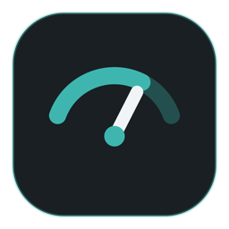
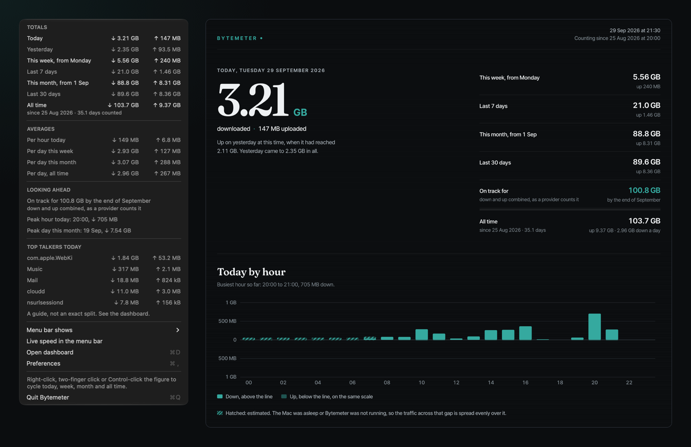
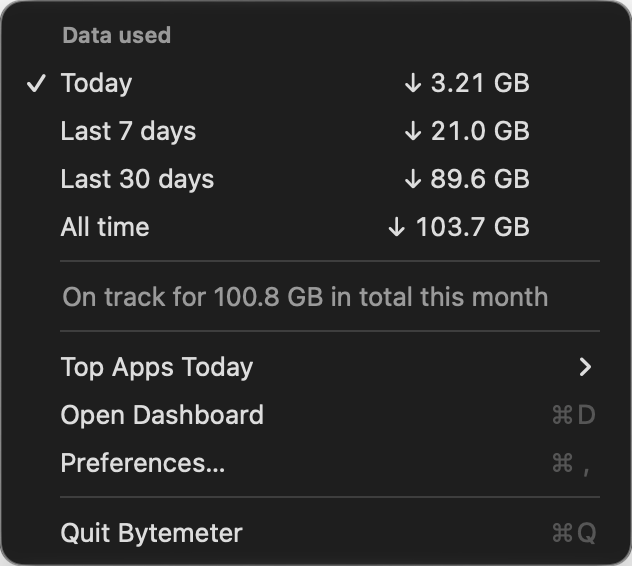
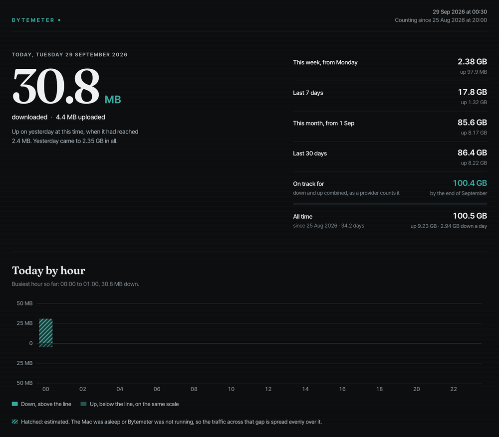
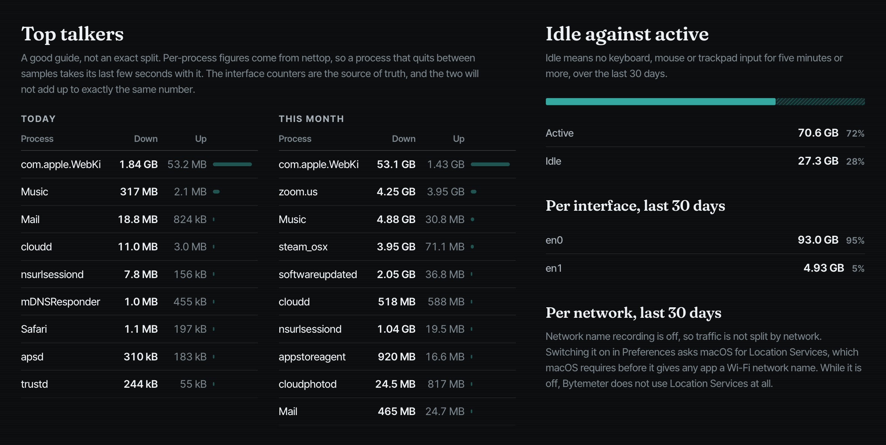
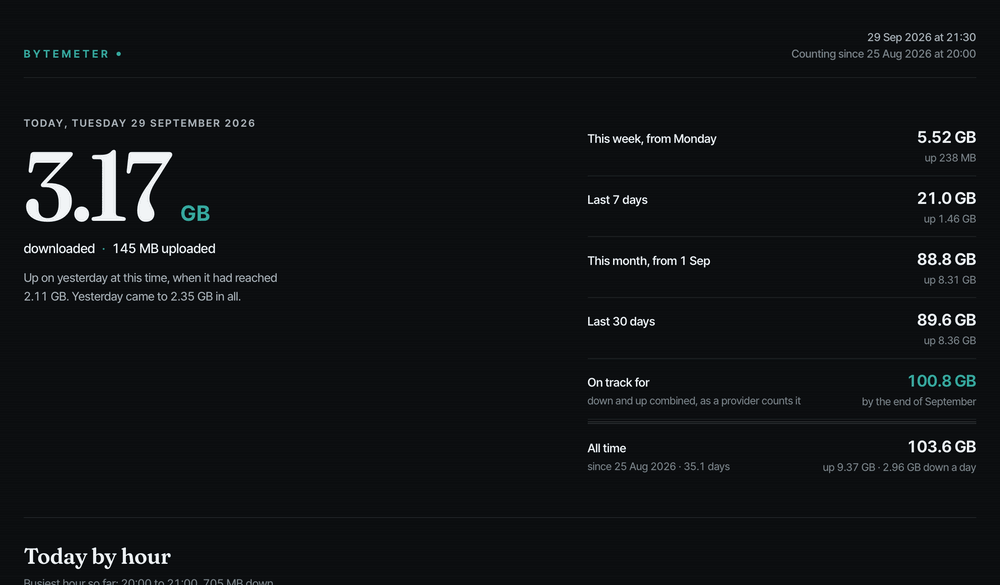
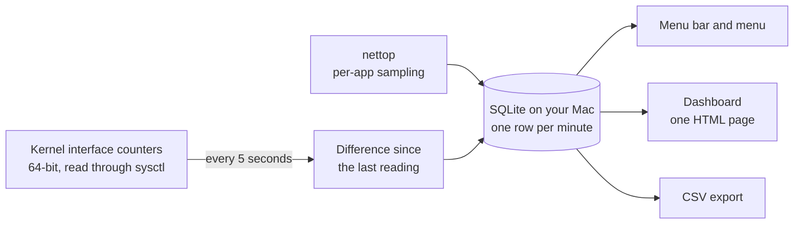

<div align="center">



<h1>Bytemeter</h1>

**A macOS menu bar app that counts every byte your Mac sends and receives, and never sends one itself.**

Totals in the menu bar, a dashboard with charts, a CSV export. Everything stays on your Mac.

[](https://github.com/Adi-debug-source/bytemeter/actions/workflows/test.yml)
[](https://github.com/Adi-debug-source/bytemeter/releases/latest)
[](LICENSE)
[](#install)

</div>

<p align="center">
  
</p>

Bytemeter sits in the menu bar and shows how much data your Mac has used today, this week, this month or since it started counting. Click it for the detail, or open the dashboard. It is written in Swift, has no dependencies, and makes no network requests of any kind: a tool that measures data use should not spend data.

Every picture and clip on this page is the real app showing a generated month of invented traffic (`Scripts/make_demo_db.py`), not anyone's usage.

## Install

```bash
git clone https://github.com/Adi-debug-source/bytemeter.git
./bytemeter/install.sh
```

That builds the app on your Mac, puts it in `~/Applications` and starts it at login. Run the second line again after a `git pull` to update.

Or with [Homebrew](https://brew.sh):

```bash
brew tap adi-debug-source/bytemeter https://github.com/Adi-debug-source/bytemeter
brew install adi-debug-source/bytemeter/bytemeter
bytemeter-setup
```

Both routes need macOS 13.5 or later and the Xcode Command Line Tools (`xcode-select --install`), not full Xcode. [Install and remove](#install-and-remove) has the options and how to uninstall.

## What you get

### A total in the menu bar, and a menu with the detail

<table>
<tr>
<td width="40%" valign="top">

</td>
<td valign="top">

- **One figure, always in view.** Today, this week, this month or all time. Choose which from the menu, or right-click the figure to step through them. A live speed can sit beside it.
- **Seven totals and four averages**, each with download and upload, all worked out from the same rows, so no two figures can disagree.
- **Where the month is heading.** A projection for the month's end, download and upload combined as a provider counts them, with the busiest hour and day.
- **A monthly cap.** Set your allowance in GB and the day your billing cycle starts, and the menu shows a bar with what is used, what is left and how many days are to go.
- **Top talkers.** The apps that used the most today, sampled with `nettop`.

The digits are monospaced, so the menu bar item does not jitter as the figure changes.

</td>
</tr>
</table>

### A dashboard that is one file

Open dashboard writes a single dark HTML page and opens it: hand-written HTML and inline SVG, no JavaScript, nothing fetched. This is one invented day, a page every half hour:

<p align="center">
  
</p>

Below the headline it has seven sections, and an eighth once a second month begins. Some of them:

<table>
<tr>
<td width="50%" valign="top">

<br><b>The last 30 days</b>, with a seven-day average of whole days, which stops at yesterday because today is not over.
</td>
<td width="50%" valign="top">

<br><b>When the data goes</b>: day of the week against hour of the day, an average over the last four whole weeks.
</td>
</tr>
<tr>
<td colspan="2" valign="top">

<br><b>Top talkers, idle against active, and each interface</b>, so a phone sharing its connection over a cable is told apart from the Wi-Fi. With the Wi-Fi network name switched on, traffic is split by network too.
</td>
</tr>
</table>

<details>
<summary>The whole page, top to bottom, in six stops</summary>
<p align="center">
  
</p>
</details>

A **CSV export** sits beside the page as a real file, with exact byte counts. [The guide](docs/guide.md) covers every row of the menu, the five settings in Preferences and each section of the dashboard.

## Privacy

Nothing leaves your Mac. Bytemeter makes no network requests at all, not for charts, fonts or updates, and the dashboard fetches nothing when you open it. There are no accounts and no analytics. CI fails the build if the dashboard page ever contains a script or a web address.

It reads the kernel's own interface byte counters every 5 seconds, keeps per-app totals from `nettop`, and writes minute-level rows to a local SQLite database:

```
~/Library/Application Support/Bytemeter/bytemeter.db
```

Minute rows are kept for 90 days, then collapsed to hourly, so on a typical machine the file levels off at roughly 40 MB and then grows by a few MB a year. Its log is at `~/Library/Logs/Bytemeter/bytemeter.err`.

Reading your Wi-Fi network name is off by default, and while it is off Bytemeter never touches Location Services. Switching it on in Preferences asks macOS for Location Services, because macOS treats a network name as location information. If you refuse, the feature switches itself back off and tells you where to allow it. Because each build is ad-hoc signed afresh, macOS may forget the permission after an update. Bytemeter never asks again on its own: Preferences says that network names are not being recorded, and offers to ask macOS again.

[SECURITY.md](SECURITY.md) says what counts as a security report and how to send one privately.

## Why you can trust the figures

Bytemeter is a small project with one claim: its figures match what the network interfaces carried. Most of the work is in keeping that claim true.

- **It found a trap in the usual way of counting.** `getifaddrs`, which most examples use, returns 32-bit byte counters on macOS, so they wrap every 4.29 GB and quietly lose it. Bytemeter reads the 64-bit counters from the interface MIB through `sysctl` instead, and its figures match `netstat -ib` exactly.
- **It is tested where it matters.** The self-test runs 1,280 checks on the counting rules: restarts, interface resets, counter wraps, sleep, a clock set backwards, clock changes in every time zone, database upgrades from every earlier version, and a failed write that must move nothing. CI runs it on every push, builds the app from a clean clone and checks that the dashboard page fetches nothing.
- **Every figure comes from one table.** Totals, averages, the projection and the charts are all worked out from the same minute rows when they are asked for, so no two figures on screen can disagree.
- **It has no dependencies.** Swift, AppKit, SQLite and `nettop`, all of which ship with macOS. It builds with the Command Line Tools alone.
- **Its cost is measured, not guessed.** Sitting in the menu bar it takes 0.05% to 0.07% of one processor core and about 12 MB of memory on the Mac it was developed on, or 0.7% with the live speed redrawing every second. `Scripts/measure_idle.sh` and `swift run -c release BytemeterSelfTest --measure` repeat the measurement.
- **It says what it does not know.** Per-app figures are a guide, traffic across a sleep has its timing estimated and is drawn hatched, and every known gap is written down with its size in [How accurate it is](docs/accuracy.md).

On the Mac it was developed on, the sum of every saved minute since the last reboot matched the kernel counter's own movement over the same period to 0 bytes in and 0 bytes out, checked repeatedly over several days, across two reinstalls and a database migration.

## How it works



1. **The interface counters are read every 5 seconds**, each reading diffed against the last, and the difference added to a one-minute row. Everything above a minute is computed from those rows when it is asked for.
2. **The last raw reading is saved after every sample**, so traffic that happened while the app was not running is picked up at the next launch rather than lost.
3. **A reading lower than the last one is a reset, not negative traffic.** The kernel's boot session id tells a genuine reboot from an interface reset, and no phantom spike is booked.
4. **Only physical interfaces are counted.** A VPN's tunnel carries the very same bytes as the Wi-Fi underneath it, and counting both would double every figure.
5. **Units are decimal:** 1 GB is 1,000,000,000 bytes, the way providers and routers count, so the figures are in the same units as your bill.

[How it works, and why](docs/how-it-works.md) has the full account, including where the 64-bit counters come from and how the menu bar figure stays cheap.

The code is in four parts, split on purpose:

| Part | What it is |
|---|---|
| `Sources/BytemeterCore` | The engine: reading the counters, spotting resets, minute buckets, the SQLite schema, every total and the menu's wording. Nothing macOS-only, so an iOS version could use it untouched |
| `Sources/BytemeterDashboard` | The dashboard page and the CSV export, built from the engine with Foundation alone |
| `Sources/Bytemeter` | The macOS app: the menu bar item, per-app sampling, the Wi-Fi network name, Preferences, sleep and wake |
| `Sources/BytemeterSelfTest` | The checks, one file per subject |

## Questions

<details>
<summary><b>Why is there no download, only a build?</b></summary>

Bytemeter is not notarised, and it does not need to be. Both install routes build it on your own Mac, so there is no downloaded app for macOS to quarantine, and it opens without a warning. A prebuilt, ad-hoc signed app would be refused by Gatekeeper.
</details>

<details>
<summary><b>Why does my provider's figure differ?</b></summary>

Expect small differences, not a match to the byte. A provider or router counts at its own point in the network and in its own way, and a router counts every device on the connection, while Bytemeter counts only what this Mac's own interfaces moved. Traffic inside your own network counts too: Time Machine to a network disk, a NAS, AirPlay, screen sharing and copies between Macs, though none of it reaches your provider.
</details>

<details>
<summary><b>Is traffic counted twice when a VPN is on?</b></summary>

No. Only physical interfaces are counted, meaning `en` followed by a number. VPN tunnels, bridges, AirDrop and loopback are all left out.
</details>

<details>
<summary><b>How exact are the per-app figures?</b></summary>

They are a guide, not an exact split. They come from `nettop`, and a process that exits between samples takes its last few seconds with it, so they only ever under-report. The interface counters are the source of truth.
</details>

<details>
<summary><b>What happens across a sleep, a restart or a crash?</b></summary>

The bytes are counted. Traffic across a sleep is real, so it is counted, but its timing is not observed: it is spread evenly across the gap and drawn hatched. After a restart, everything on the counter since boot is counted. After a crash, the login item restarts the app within seconds and it picks up everything since the last reading.
</details>

<details>
<summary><b>What does 'all time' mean?</b></summary>

Since Bytemeter started counting, not since the Mac was new. Traffic already on the counter when Bytemeter first runs has no timestamps, so it is left out rather than folded in to flatter the figure.
</details>

<details>
<summary><b>Is it the first of its kind?</b></summary>

No. Other menu bar data meters exist, some with alerts and per-app limits. Bytemeter's part is being exact, open and private.
</details>

## Install and remove

`install.sh` builds the app with `swift build -c release`, ad-hoc signs `Bytemeter.app`, copies it to `~/Applications`, and adds a login item so it starts at login. The login item restarts the app after a crash, but if you quit it, it stays quit until the next login. It is safe to run again after `git pull` to update. The options are:

- `--uninstall`: removes the app and the login item, and keeps your data.
- `--dry-run`: says what it would do and changes nothing.
- `--bundle-only DIR`: builds the app without installing it.
- `--app PATH`: installs an app that is already built.

With Homebrew, the formula lives in this repository, so `brew tap` points Homebrew at it once. `brew install` fetches and builds Bytemeter. `bytemeter-setup` copies the app to `~/Applications` and adds the login item, because Homebrew cannot write to your home folder itself. After `brew upgrade bytemeter`, run `bytemeter-setup` again. To remove it, run `bytemeter-setup --uninstall`, then `brew uninstall bytemeter`; your usage history is kept.

Building needs macOS 13.5 or later, the first release that runs Swift 5.9, and the Command Line Tools, version 15 or later.

## Build and test

```bash
swift build -c release                     # build
swift run -c release BytemeterSelfTest     # run the self-test, 1,280 checks
```

The self-test is a plain executable rather than an XCTest target because XCTest is not part of the Command Line Tools, and this project does not assume full Xcode. Swift Testing does run under the Command Line Tools, but it needs Swift 6, which would raise the minimum macOS. CI runs the self-test on every push, builds the app bundle from a clean clone, builds the demo dashboard and checks it fetches nothing, and verifies the bundle's signature.

<details>
<summary>Measuring what it costs, and working with a database directly</summary>

Two commands measure what Bytemeter costs, so a change that claims to be faster can show it:

```bash
swift run -c release BytemeterSelfTest --measure   # the engine: a reading, the menu bar figure, the menu, the dashboard
Scripts/measure_idle.sh                            # the running app: processor time and memory while idle
```

After `swift build -c release`, the binary is at `.build/release/Bytemeter`. Two commands work on a database other than the live one, and a script makes a synthetic one:

```bash
.build/release/Bytemeter --dashboard <folder> [--as-of <time>]   # build the dashboard as it was at that moment
.build/release/Bytemeter --demo <folder> [--as-of <time>]        # run the real menu, read-only, against a demo database
python3 Scripts/make_demo_db.py <folder> [--now <time>]          # make a synthetic month
```

The pictures and clips in this README are made this way, from invented data, so nothing real is shown. The exact commands that reproduce them are in [MAINTENANCE.md](MAINTENANCE.md#screenshots-and-clips).
</details>

## Contributing

Issues and pull requests are welcome. A bug report is most useful with the version (`VERSION`), what the menu or dashboard showed, and what you expected. For a change:

1. Run `swift run -c release BytemeterSelfTest` before and after. It is the gate, and a fix for a counting bug comes with a check that fails without it.
2. Keep the engine free of AppKit and the dashboard free of scripts and web addresses. CI checks the second.
3. Read [MAINTENANCE.md](MAINTENANCE.md) for how the parts fit together, the login item and the release steps, and [CHANGELOG.md](CHANGELOG.md) for what each version changed and why.

[AGENTS.md](AGENTS.md) holds the working rules for coding agents on this repository; they are a fair summary of the standards for people too. Report a vulnerability privately, as [SECURITY.md](SECURITY.md) describes.

## Licence

MIT, see [LICENSE](LICENSE). Copyright (c) 2026 Aditya Kumar.

The dashboard carries two fonts under the SIL Open Font License 1.1: Fraunces, by The Fraunces Project Authors, and Inter Tight, by The Inter Project Authors. Their licences are `OFL-Fraunces.txt` and `OFL-InterTight.txt` in [Resources/Fonts](Resources/Fonts).
