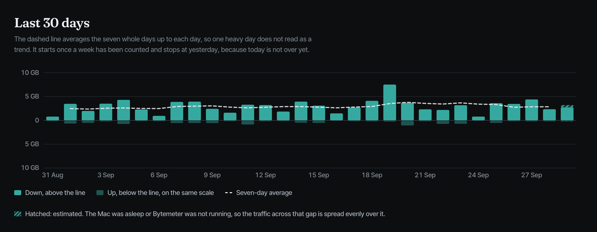
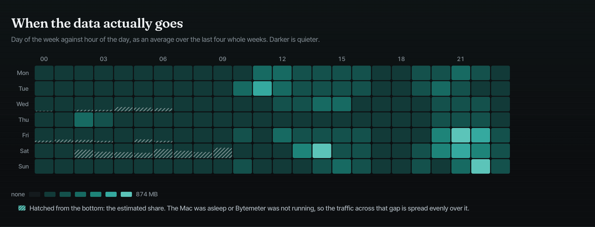

# A guide to Bytemeter

Everything the menu bar item, the menu, Preferences and the dashboard show, in full. The [README](../README.md) has the short version.

## The menu bar

The menu bar item shows one total, with monospaced digits so its width does not jitter as the figure changes.

- Left-click opens the menu.
- **Menu bar shows**, in the menu, chooses the total: Today, This week, This month (This cycle, on a billing cycle) or All time. Right-click, a two-finger click or a Control-click on the figure steps through the same four. The choice is kept across restarts.
- Live speed is a separate switch in the menu. When it is on, the current rate appears beside the total; it never replaces it.

The menu holds:

- **Totals:** today, yesterday, this week (from Monday), the last 7 days, this month (from the 1st), the last 30 days, and all time since counting began. The four totals the menu bar can show are drawn at full contrast; the rest are grey. All time shows its start date and day count beneath it, for example "since 1 Jan 2026 · 90.0 days counted".
- **Averages:** per hour today, per day this week, per day this month, and per day across all time.
- A **month-end projection** (download and upload combined, as a provider counts them), the **peak hour** and the **peak day**, and the **cap** when one is set. Every other headline figure is download; the projection and the cap are the figures that add the two together, and the projection says so beside its figure. The projection carries the month's rate so far on to its end. On the first day of a month it runs the last 24 hours on instead, and with under a day counted at all it says it is too early to project.
- **Top talkers** today, per app.
- **Menu bar shows**, **Live speed in the menu bar**, **Open dashboard** (⌘D), **Preferences** (⌘,) and **Quit Bytemeter** (⌘Q).

If recording stops because the database cannot be written, for example on a full disk, a line at the top of the menu says so and since when, and on a new install, until the first figures arrive, it says counting has started.

## Preferences

Preferences, from the menu, has five settings:

1. **Live speed in the menu bar**, beside the total and never in its place. It can be switched from the menu too.
2. **Per-app sampling with `nettop`**, on by default. While it is off, nothing new is recorded per app, the menu says so where Top talkers would be, and the dashboard's Top talkers says so too.
3. **The Wi-Fi network name**, off by default. It needs Location Services, for the reasons under [Privacy](../README.md#privacy). While it is on and macOS allows it, the dashboard splits traffic by network.
4. **A monthly cap in GB**, off by default. The menu shows a bar with the percentage used, and the dashboard a Monthly cap panel, and both say what is left and how many days are to go, or how far over the cap the month is. It counts download and upload together, as a provider does, over the month or the billing cycle below. It is a figure to watch, and sends no alert.
5. **The day the billing cycle starts**, from 1 to 28. 1, the default, means calendar months. On any other day, this month becomes this cycle in the menu and on the dashboard, including the averages, the projection, the peak day and Month by month.

## The dashboard

Open dashboard writes one dark, self-contained HTML page and opens it. It is made again each time, with hand-rolled inline SVG and native SVG tooltips: zero JavaScript, zero network requests. A CSV export sits beside it as a real file.

The top of the page gives today's download, compared with yesterday at the same time of day, beside this week, the last 7 days, this month, the last 30 days, the projection and all time, then a Monthly cap panel when a cap is set.

Seven sections, and an eighth once a second month begins:

1. Today, by hour.
2. The last 30 days, with a seven-day average of whole days counted, which stops at yesterday because today is not over.
3. A day-of-week against hour-of-day heatmap, an average over the last four whole weeks, so every weekday counts the same.
4. Top talkers, per app.
5. Idle against active.
6. Per interface, each under the name macOS gives its port, such as Wi-Fi (en0) or iPhone USB (en7), so a phone sharing its connection over a cable is told apart from the Wi-Fi.
7. Per network.
8. Month by month, once a second month begins.

The footer says how the figures are made and lists recent events in plain words, such as a sleep with how long it lasted and how much traffic was spread across it.

[Back to the README](../README.md)
